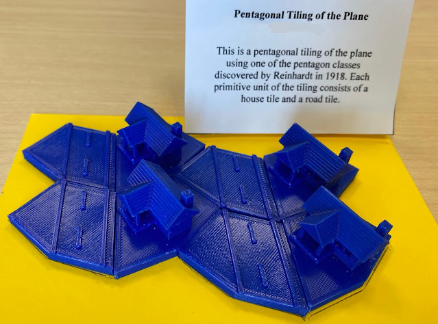

Fall 2021 GMU Math 401, Mathematics Through 3D Printing, Pentagon Tiling Assignment: A student’s rendition of one of the Reinhardt 1918 planar pentagon tilings. A method for automated suburb creation? OpenSCAD code modified from one by mathgrrl.

