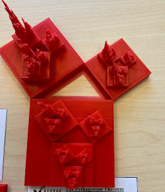
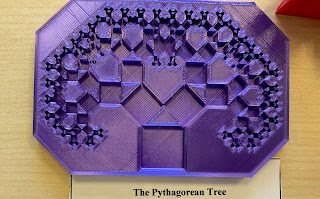
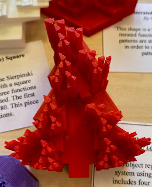
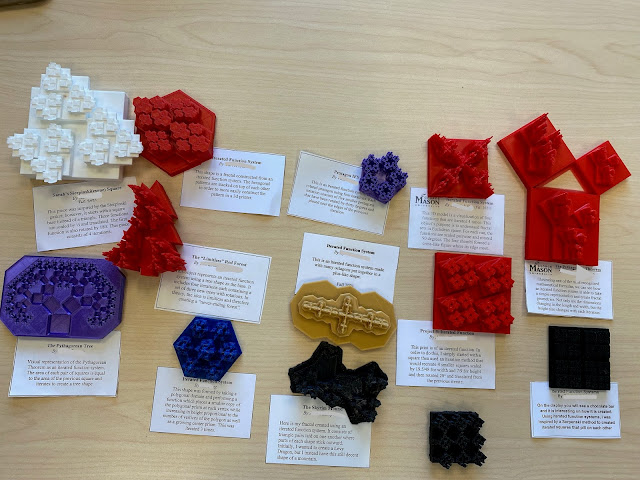
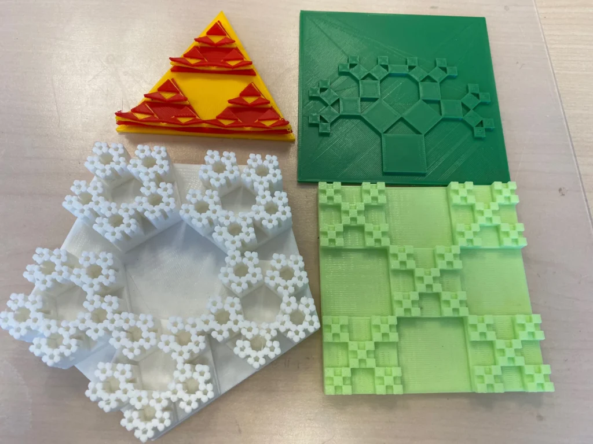

In Fall 2021, GMU Math 401, Mathematics Through 3D Printing, created iterated function systems.

  <figure></figure>
  <figure></figure>
  <figure></figure>
  <figure></figure>
  <figure></figure>

