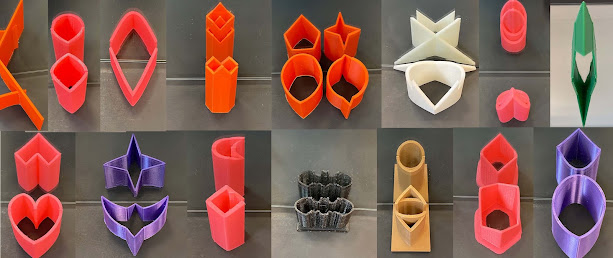

In Fall 2021, GMU Math 401, Mathematics Through 3D Printing created mathematical optical illusions. These are objects such that the shape look totally different in the mirror. In each case, you are looking at an object and its mirror image. A diamond becomes a crescent moon, a batman symbol is rightside up both in reality and in the mirror. How does it work? Mathematics! And a clever idea by Sugihara. 

