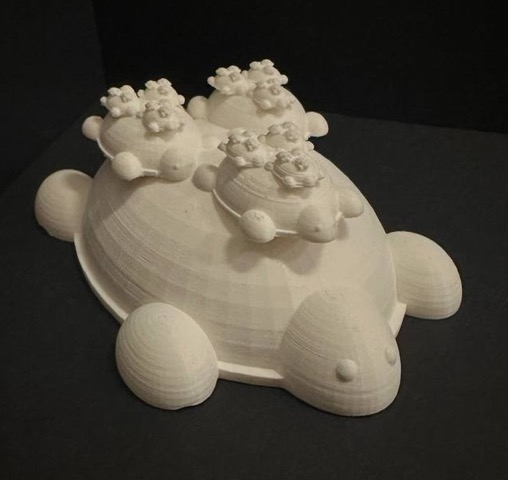

Nicole Savir of the Math Makerlab has had an art piece accepted to the <a href="https://www.ams.org/publicoutreach/math-imagery/2026-exhibition">JMM 2026 Mathematical Art Exhibition</a>.

<strong>Turtles All The Way Down</strong>

by Nicole Savir

The print references an anecdote by mathematician Bertrand Russell, where a woman suggests the world sits on a giant turtle, and when asked what the turtle stands on, she responds: “It’s turtles all the way down!”

The turtles were born from an adaptation of Dr. Sander’s direct recursion code via OpenSCAD. We define the system f = f1 ∪ f2 ∪ f3, where for each iterate n, the functions generate 3n turtles uniformly scaled by 1/2n in each dimension and translated by vectors. We define our limiting turtle set as T. T has an uncountable number of turtles and each limiting turtle has infinite turtles underneath. The fractal dimension of T is determined by covering T with 3n closed boxes of size 1/2n. As n → ∞, the dimension limits to ≈1.585.

