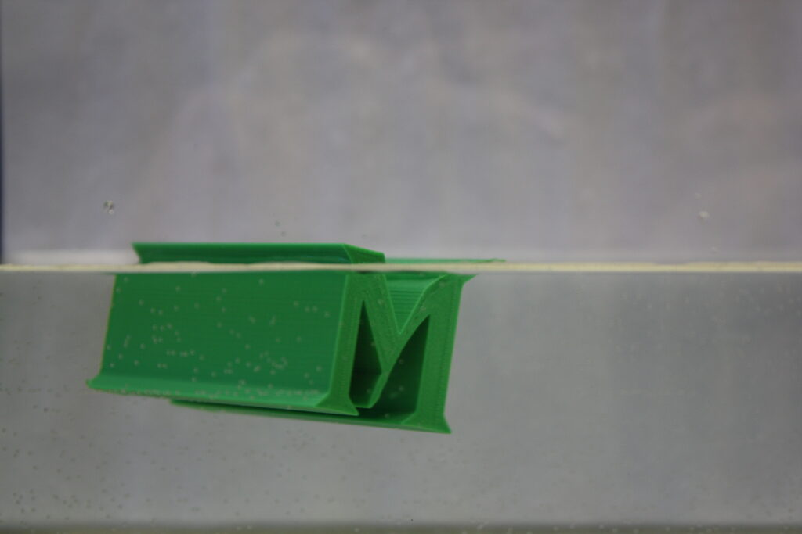

Members of the GMU Math Makerlab published a paper:

Daniel M. Anderson, Brandon G. Barreto-Rosa, Joshua D. Calvano, Lujain Nsair, and Evelyn Sander (Edited by Maria Trnkova and Andrew Yarmola), <a href="https://doi.org/10.1090/psapm/079/00710">Mathematics of Floating 3D Printed Objects</a>, <em>Proceedings of Symposia in Applied Mathematics (PSAPM)</em>, 2023.

