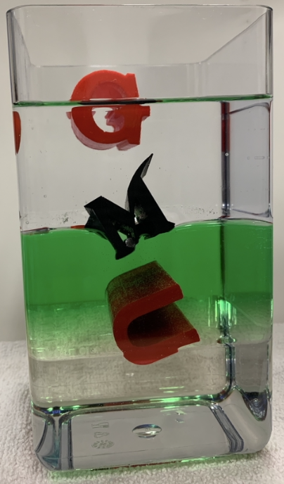

GMU Math Makerlab members published a paper:

Daniel M. Anderson, Patrick R. Bishop, Mark Brant, Gabriela Castaneda Guzman, Evelyn Sander, and Gina Thomas, <a href="https://doi.org/10.1088/1361-6404/ad5ca8">Stability of Floating Objects at a Two-Fluid Interface</a>, <em>European Journal of Physics</em>, 45: 055001, 2024.

