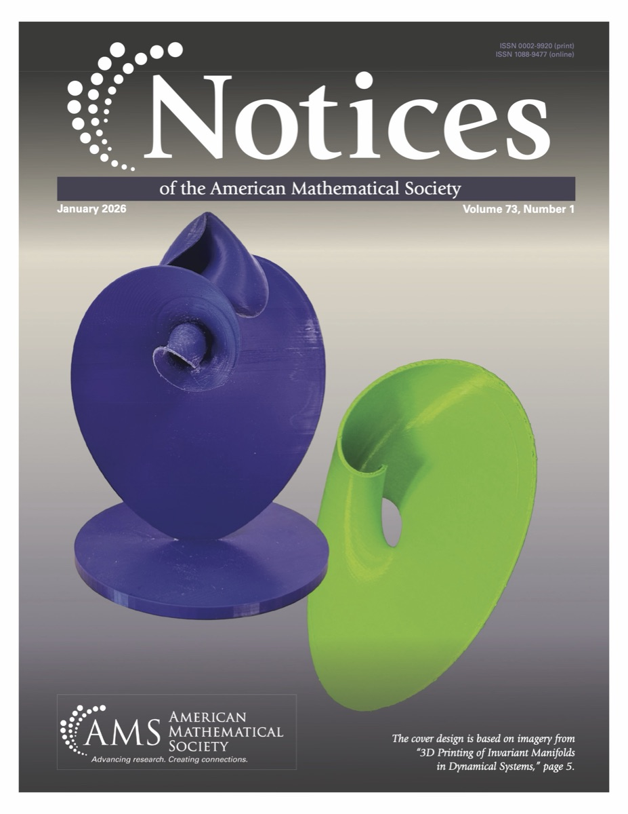

The following paper appeared: Patrick R. Bishop, Summer Chenoweth, Emmanuel Fleurantin, Alonso Ogueda-Oliva, Evelyn Sander, and Julia Seay, 3D Printing of Invariant Manifolds in Dynamical Systems, <em>AMS Notices</em>, 73(1): 5-15 (2026), doi:10.1090/noti3288, 2026.

