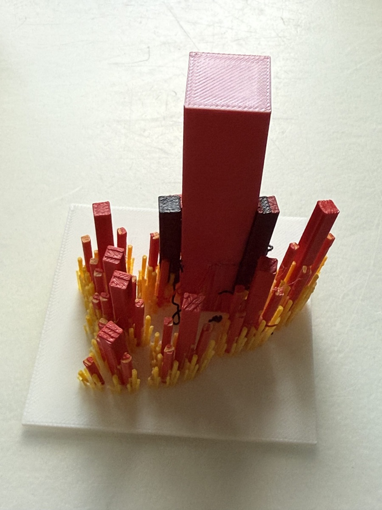
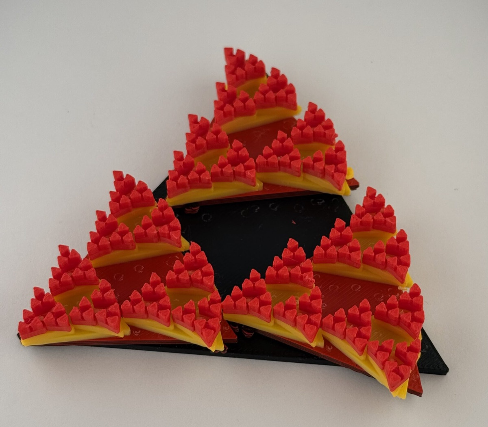
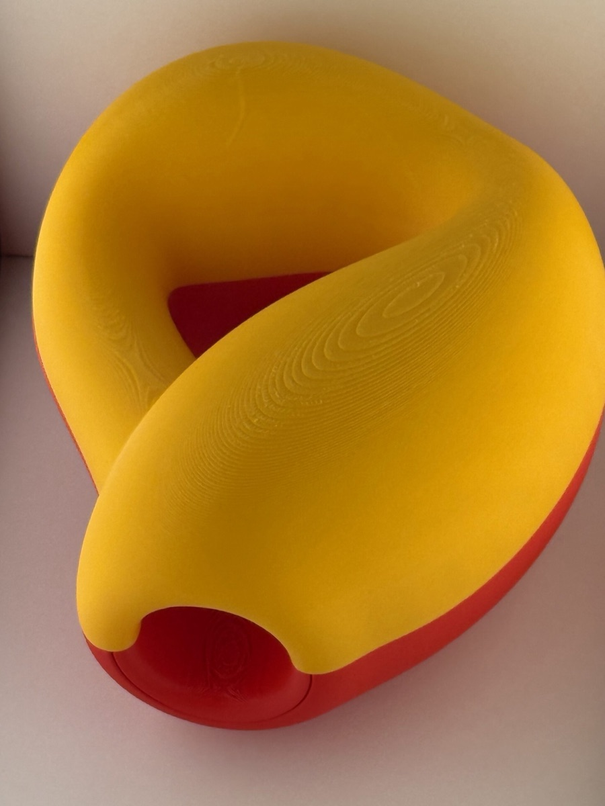
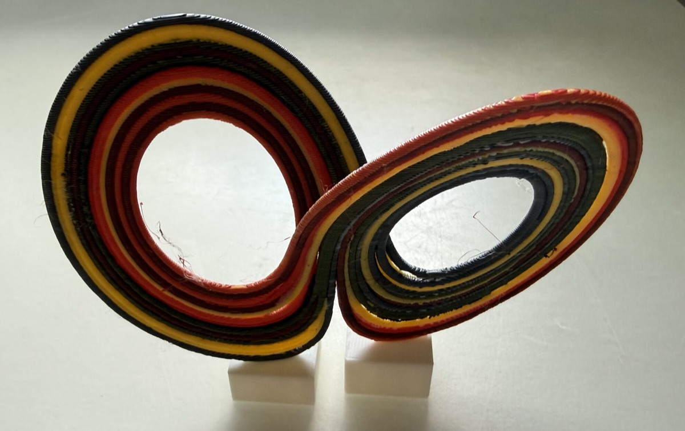
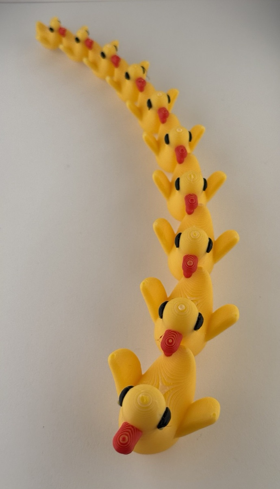
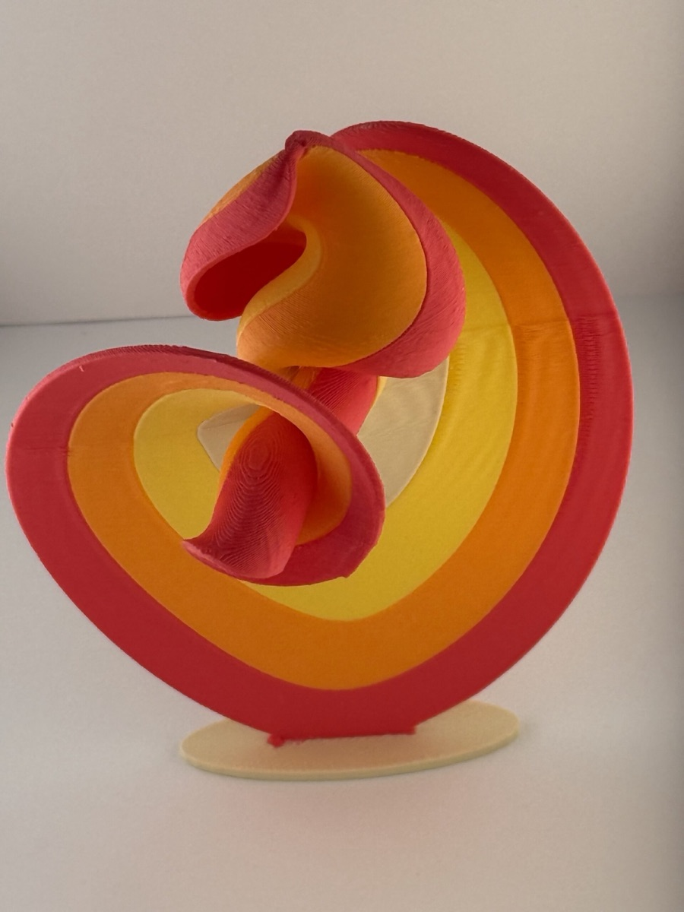

  <figure><figcaption>Fractals</figcaption></figure>
  <figure><figcaption>More Fractals</figcaption></figure>
  <figure><figcaption>A Klein bottle that you can open so you can see that it is made from two Möbius strips</figcaption></figure>
  <figure><figcaption>The 10 simplest periodic orbits for the Lorenz system</figcaption></figure>
  <figure><figcaption>Recursive ducks</figcaption></figure>
  <figure><figcaption>Lorenz manifold to show how it grows out from the equilibrium.</figcaption></figure>
  <figure><video controls preload="metadata" src="/images/makerlab/news/clebsch-surface.mov" aria-label="Video of a 3D printed Clebsch surface"></video><figcaption>A Clebsch surface</figcaption></figure>

